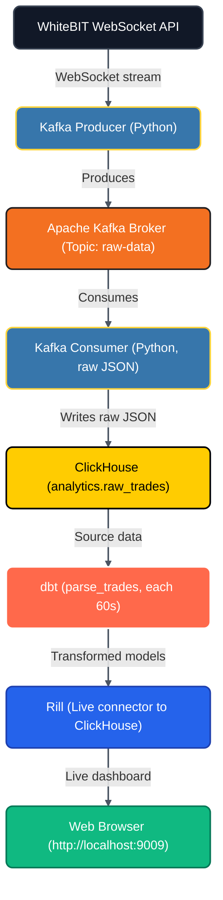

# Real-Time Crypto ETL Pipeline (WhiteBIT → ClickHouse → DBT -> Rill)

A fully containerized data pipeline that ingests real-time cryptocurrency trades from the WhiteBIT WebSocket API (BTC USDT), streams them through Kafka, stores them in ClickHouse, transforms them with dbt, and visualizes them in Rill.

## Tech Stack

- **Ingestion:** Python, Apache Kafka (KRaft)
- **Storage:** ClickHouse
- **Transformation:** dbt (dbt-clickhouse)
- **Visualization:** Rill (BI-as-code)
- **Infrastructure:** Docker, Docker Compose

## Architecture



## How to run
```bash
git clone git@github.com:YuryNitochkin/Whitebit_BTC_USDT_ETL_Realtime.git
cd Whitebit_BTC_USDT_ETL_Realtime
chmod +x start.sh
./start.sh
```

## The script waits for the first trades to arrive in ClickHouse and prints the dashboard link:

```http://localhost:9009/explore/parse_trades_metrics```

## To stop:

```bash
docker compose down
```

### Limitations
1. Refresh interval: dbt runs every 60 seconds. This is configurable via the DBT_RUN_INTERVAL environment variable in docker-compose.yml.

2. Tested environment: Linux (WSL 2 on Windows). Not tested on macOS (Apple Silicon/ARM64) or native Windows.

3. .env file: Committed intentionally for demonstration. It contains only local, non-sensitive credentials for the Docker network. In production, this is not acceptable — use a secret manager.

4. BI choice: Rill was chosen over Lightdash/Metabase/Superset/Redash because it supports "BI-as-code" (YAML dashboards) and does not require an S3 bucket or a separate CLI/DB/WEB server deployment step.

